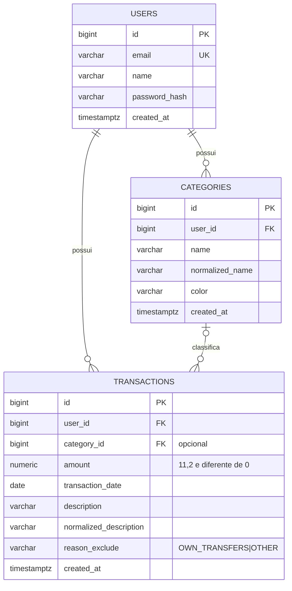
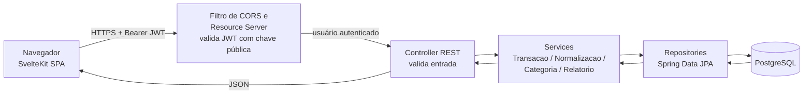

# TrackFlow — Especificação do Projeto 1.1

> **v1.1:** modelo de dados alinhado às migrations V1 a V3 (nomes em inglês, tipos e constraints ajustados, FK composta
> com `ON DELETE SET NULL (category_id)`). Diferenças em relação à v1.0 na seção 5.3.
>
> **v1.0:** categorização manual no MVP, sem regras criadas pelo usuário; categorização automática probabilística movida
> para a fase OFX (ADR-005, seção 11).

> Legenda: **[MVP]** entra na primeira entrega · **[Futuro]** registrado na seção 10 · **[IA]** decisão sugerida por IA.

---

## 1. Levantamento do problema

**Problema hoje.** Quem quer controlar gastos usa planilha (exige conhecimento e tempo para montar), caderno (manual,
sem correção limpa, refeito todo mês) ou apps (recursos úteis são pagos; a automação via Open Finance é burocrática).
Resultado: muita gente nunca chega a controlar os gastos.

**Solução.** O TrackFlow é um app web gratuito em que o usuário registra receitas e despesas, escolhe a categoria de
cada transação a partir de categorias padrão e consulta um painel mensal que mostra para onde o dinheiro foi. A
categorização automática chega junto com a importação de extratos (fase futura).

**Público-alvo.** Pessoas de 20 a 30 anos que nunca controlaram seus gastos por falta de tempo e não querem pagar por
automação (faixa etária é hipótese, não validada).

**Resultado esperado**

- **Ao concluir o MVP:** o usuário registra transações manualmente, escolhe a categoria, revisa as transações sem
  categoria e consulta o painel mensal com comparação ao mês anterior. O MVP prova viabilidade técnica e dá sinais
  iniciais de utilidade; **não comprova demanda de mercado**.
- **Ao concluir o projeto:** além do MVP, importação de extratos OFX com categorização automática por probabilidade, de
  modo que um mês possa ser registrado e analisado em até 30 minutos (meta a validar com arquivos reais e usuários).

---

## 2. Levantamento de requisitos

### 2.1 Atores

| Ator    | Descrição                                                                                |
|---------|------------------------------------------------------------------------------------------|
| Usuário | Único perfil. Registra transações, categoriza e consulta o painel. Não há administrador. |
| Sistema | Normaliza descrições e calcula totais.                                                   |

Não há serviços externos em tempo de execução.

### 2.2 Requisitos funcionais

| ID    | Requisito                                                                                                                                                                                                |
|-------|----------------------------------------------------------------------------------------------------------------------------------------------------------------------------------------------------------|
| RF-01 | Cadastro, login e logout                                                                                                                                                                                 |
| RF-02 | Registrar transação manual: data, descrição, tipo (despesa/receita), valor positivo, categoria opcional                                                                                                  |
| RF-03 | Avisar sobre possível duplicata (mesma data, valor e descrição normalizada) e permitir confirmar                                                                                                         |
| RF-04 | Normalizar a descrição para detectar duplicatas e agrupar                                                                                                                                                |
| RF-05 | *(removido: categorização automática vai para o futuro, ver seção 11)*                                                                                                                                   |
| RF-06 | Atribuir ou alterar a categoria de uma transação. Opcionalmente, aplicar a mesma categoria às demais transações sem categoria do mesmo grupo de descrição normalizada (ação pontual, **não cria regra**) |
| RF-07 | Listar transações por mês, categoria e situação (sem categoria/categorizada/não conta)                                                                                                                   |
| RF-08 | Editar e excluir transações                                                                                                                                                                              |
| RF-09 | Listar transações sem categoria agrupadas por descrição normalizada, ordenadas por valor total                                                                                                           |
| RF-10 | Marcar/desmarcar uma transação como "não conta" com motivo visível                                                                                                                                       |
| RF-11 | Painel mensal: despesas, receitas, saldo, valores excluídos, ranking por categoria, sem categoria                                                                                                        |
| RF-12 | Comparar o painel com o mês anterior (variação total e por categoria)                                                                                                                                    |
| RF-13 | CRUD de categorias (criar, renomear, alterar cor, excluir)                                                                                                                                               |
| RF-14 | *(removido: não há regras)*                                                                                                                                                                              |
| RF-15 | Exportar todos os meus dados (JSON)                                                                                                                                                                      |
| RF-16 | Excluir minha conta e todos os dados associados                                                                                                                                                          |

### 2.3 Requisitos não funcionais

| ID     | Categoria        | Requisito                                                                                                                                                                                                            |
|--------|------------------|----------------------------------------------------------------------------------------------------------------------------------------------------------------------------------------------------------------------|
| RNF-01 | Segurança        | Cada usuário só acessa os próprios dados. O dono vem sempre do token, nunca do corpo da requisição. O banco reforça o isolamento com FKs compostas. Recurso de outro usuário retorna 404.                            |
| RNF-02 | Segurança        | Senhas com BCrypt. HTTPS obrigatório. Segredos e chaves fora do repositório.                                                                                                                                         |
| RNF-03 | Privacidade      | Guardar só o necessário. Logs sem descrições, valores, senhas ou tokens. Dados financeiros tratados como dados pessoais que exigem proteção, sem presumir enquadramento como dado sensível (LGPD).                   |
| RNF-04 | Desempenho       | Listar e resumir um mês com 5.000 transações em até 1 s no servidor (medido em teste).                                                                                                                               |
| RNF-05 | Usabilidade      | Uso confortável em celular; registrar uma transação exige no máximo 4 campos obrigatórios.                                                                                                                           |
| RNF-06 | Confiabilidade   | Operações que alteram várias linhas (aplicar a mesma categoria ao grupo, excluir categoria, cadastro com categorias padrão) são atômicas. Valores monetários em `NUMERIC(11,2)`/`BigDecimal`, nunca ponto flutuante. |
| RNF-07 | Manutenibilidade | Normalização e cálculo de totais isolados em serviços próprios, com testes automatizados e **uma única implementação** dos totais.                                                                                   |
| RNF-08 | Disponibilidade  | Sem dependência externa em tempo de execução além do banco. A partida a frio da API em plano gratuito é aceita e documentada.                                                                                        |

### 2.4 Cenários de erro

- Valor zero, negativo ou não numérico; tipo ausente; data inválida; descrição vazia.
- Categoria ou transação de outro usuário acessada por ID (retorna 404).
- Possível duplicata (aviso com confirmação, não é erro fatal).
- Token expirado, inválido ou ausente.
- Login com credenciais erradas (mensagem genérica, sem indicar qual campo falhou).
- E-mail já cadastrado.
- Nome de categoria repetido (comparação sem diferenciar maiúsculas e acentos).
- Exclusão de categoria com transações associadas (tratada conforme RN-19).
- Falha no cadastro após criar o usuário: a operação é desfeita por inteiro, sem usuário parcialmente inicializado.
- Falha de banco ou erro inesperado: resposta 500 genérica, sem detalhes internos.

### 2.5 Bloqueios de release

> **Esta seção deve ser concluída ANTES de qualquer etapa posterior ao MVP e antes de receber dados de terceiros.**
> Enquanto não estiver pronta, o app só roda com dados sintéticos e acesso restrito ao desenvolvedor.

1. Exportação dos dados do usuário em JSON (RF-15).
2. Exclusão da conta e de todos os dados associados, com texto explicando o que é apagado (RF-16).
3. Política de privacidade acessível no app, descrevendo quais dados são guardados e por quê.
4. Revisão de logs, backups e retenção do provedor do banco, para não prometer exclusão incompatível com o sistema (a
   política informa o prazo de retenção de backups do provedor).
5. Testes automatizados comprovando exportação e exclusão reais.

**Ambientes:** (1) local, dados sintéticos; (2) teste privado, acesso restrito, sem dados reais de terceiros; (3) beta
público, só após os 5 itens acima. Teste de usabilidade com outra pessoa já é uso por terceiro: usar apenas dados
fictícios, com concordância informada, sem pedir extratos reais.

---

## 3. Escopo

### 3.1 O que será feito no MVP

RF-01 a RF-16, exceto RF-05 e RF-14 (removidos), com o fluxo: **cadastrar → registrar transação → categorizar → revisar
transações sem categoria → consultar painel**.

### 3.2 Fora do MVP

Importação OFX/CSV, categorização automática (fase OFX), Open Finance, integração com bancos, visão por loja, IA/LLM,
metas e orçamentos, investimentos, multi-moeda, múltiplas contas, tema escuro, app nativo. Ver seção 10.

### 3.3 Critérios de conclusão do MVP

1. Receita e despesa registradas sem erro de sinal.
2. Usuário lista, edita e exclui apenas os próprios lançamentos.
3. Categorização manual, aplicar ao grupo e lista de transações sem categoria funcionando.
4. Painel mensal com totais corretos sobre massa de teste conhecida.
5. Testes automatizados de isolamento entre usuários e de integridade do banco passando.
6. Teste exploratório com dados fictícios registrado (seção 8.3).
7. Bloqueios de release (2.5) concluídos.
8. README publicado.

---

## 4. Regras de negócio

**Transações e totais**

- **RN-01 Tipo e sinal.** O usuário escolhe Despesa ou Receita e informa valor **positivo**. O back-end grava despesa
  como negativo e receita como positivo. Valor zero é recusado. A API sempre devolve `tipo` explícito além do valor.
- **RN-02 Moeda.** Apenas BRL, `NUMERIC(11,2)` (máximo 999.999.999,99).
- **RN-03 Mês de referência.** É o mês da `transaction_date` informada pelo usuário.
- **RN-04 Elegível.** Transação com `reason_exclude` nulo; só as elegíveis entram nos totais.
- **RN-05 Despesas** = soma dos valores negativos elegíveis, exibida como positivo. **Receitas** = soma dos valores
  positivos elegíveis. **Saldo** = receitas − despesas.
- **RN-06 "Não conta".** O usuário pode marcar uma transação como não contabilizada, com motivo `OWN_TRANSFERS`
  ou `OTHER`. Ela sai dos totais e aparece em "Não contabilizado", com o motivo visível.
- **RN-07 Estorno.** Estorno é registrado como receita comum. O painel mostra fluxo bruto, e não gasto líquido por
  categoria; o app informa isso na tela do painel.
- **RN-08 Totais.** Uma fórmula única no back-end, reutilizada por todos os endpoints. "Sem categoria" = soma e
  quantidade das **despesas** elegíveis sem categoria. "Por categoria" = apenas **despesas** elegíveis com categoria.
  Receitas sem categoria entram apenas no total de receitas.
- **RN-09 Comparação.** A variação é calculada contra o mês civil anterior, em valor e percentual; se o mês anterior for
  zero, o percentual não é exibido.

**Duplicatas**

- **RN-10 Possível duplicata.** Mesma data, valor e descrição normalizada de outra transação do usuário. Gera apenas
  aviso (resposta 409 com `possivelDuplicata`); o usuário reenvia com `confirmarDuplicata=true` para salvar.

**Normalização e categoria**

- **RN-11 Normalização da descrição.** Em ordem: converter para minúsculas → remover acentos → trocar qualquer caractere
  que não seja letra, número ou espaço por espaço → remover palavras formadas só por dígitos → reduzir espaços
  repetidos → remover espaços das pontas. Exemplo: `"MERCADO Centro 0123 - SP"` → `"mercado centro sp"`. A descrição
  original é sempre guardada junto. Transações sem categoria são agrupadas por **igualdade exata** da descrição
  normalizada. Usada apenas para detectar duplicatas (RN-10) e agrupar transações sem categoria. Não decide categoria no
  MVP.
- **RN-12 Categoria da transação.** Toda categoria no MVP é escolhida pelo usuário. Se informada no registro, a
  transação nasce categorizada; senão, fica "sem categoria".
- **RN-13 Aplicar ao grupo.** Ao categorizar com "aplicar ao grupo", todas as transações **sem categoria** do usuário
  com a mesma descrição normalizada recebem a categoria, em uma única transação de banco. Transações que já têm
  categoria **nunca** são alteradas por esta ação. Nada é guardado para uso futuro.
- **RN-14 a RN-16.** Reservadas (futuro), para manter a numeração das demais.

**Categorias**

- **RN-17 Categorias padrão.** Ao cadastrar, o usuário recebe uma cópia das **categorias padrão**, em operação atômica e
  idempotente com a criação do usuário.
- **RN-18 Nome de categoria.** Único por usuário, sem diferenciar maiúsculas e acentos (`Alimentação` = `alimentacao`).
- **RN-19 Exclusão de categoria.** Ao apagar a categoria, as transações dela voltam a ficar sem categoria (`category_id`
  nulo). Isso é feito pelo próprio banco (`ON DELETE SET NULL (category_id)`), na mesma operação da exclusão. Transações
  nunca são apagadas.

**Conta e dados**

- **RN-20 Exclusão de conta.** Apaga o usuário e, em cascata, categorias e transações.
- **RN-21 Exportação.** O JSON contém dados da conta (sem senha), categorias e transações.

---

## 5. Modelo de entidades

### 5.1 Tabelas

Nomes de tabelas, colunas e valores de enum em inglês. As migrations V1 a V3 (Flyway) já implementam `users`,
`categories` e `transactions`.

#### users

| Coluna        | Tipo         | Restrições                                                                    |
|---------------|--------------|-------------------------------------------------------------------------------|
| id            | BIGINT       | PK, identity                                                                  |
| email         | VARCHAR(255) | NOT NULL, `users_email_uk` UNIQUE (guardado em minúsculas **pela aplicação**) |
| name          | VARCHAR(60)  | NOT NULL (nome exibido no perfil; **não é único**, preenchido pelo usuário)   |
| password_hash | VARCHAR(255) | NOT NULL                                                                      |
| created_at    | TIMESTAMPTZ  | NOT NULL, default `now()`                                                     |

#### categories

| Coluna          | Tipo        | Restrições                                                                      |
|-----------------|-------------|---------------------------------------------------------------------------------|
| id              | BIGINT      | PK, identity                                                                    |
| user_id         | BIGINT      | NOT NULL, FK → users (id) ON DELETE CASCADE                                     |
| name            | VARCHAR(60) | NOT NULL                                                                        |
| normalized_name | VARCHAR(60) | NOT NULL (nome normalizado: minúsculas, sem acentos, preenchido pela aplicação) |
| color           | VARCHAR(7)  | NULL; `categories_color_fmt_ck`: formato `#RRGGBB`                              |
| created_at      | TIMESTAMPTZ | NOT NULL, default `now()`                                                       |
| —               | —           | `categories_id_user_id_uk` UNIQUE (id, user_id)                                 |
| —               | —           | `categories_user_id_normalized_name_uk` UNIQUE (user_id, normalized_name)       |

#### transactions

| Coluna                 | Tipo          | Restrições                                                                                                                     |
|------------------------|---------------|--------------------------------------------------------------------------------------------------------------------------------|
| id                     | BIGINT        | PK, identity                                                                                                                   |
| user_id                | BIGINT        | NOT NULL, `transactions_user_id_fk` FK → users (id) ON DELETE CASCADE                                                          |
| category_id            | BIGINT        | NULL (sem FK própria; participa da FK composta abaixo)                                                                         |
| amount                 | NUMERIC(11,2) | NOT NULL, `transactions_amount_valid_ck` CHECK (amount <> 0)                                                                   |
| transaction_date       | DATE          | NOT NULL                                                                                                                       |
| description            | VARCHAR(255)  | NOT NULL (descrição original informada pelo usuário)                                                                           |
| normalized_description | VARCHAR(255)  | NOT NULL                                                                                                                       |
| reason_exclude         | VARCHAR(60)   | NULL; `transactions_reason_exclude_enum_ck` CHECK IN ('OWN_TRANSFERS', 'OTHER')                                                |
| created_at             | TIMESTAMPTZ   | NOT NULL, default `now()`                                                                                                      |
| —                      | —             | `transactions_user_category_fk` FOREIGN KEY (user_id, category_id) → categories (user_id, id) ON DELETE SET NULL (category_id) |

**Observação:** com `category_id` nulo a FK composta não é verificada, então transação sem categoria é válida. O
`ON DELETE SET NULL (category_id)` zera só essa coluna e preserva `user_id`; exige **PostgreSQL 15 ou superior**
(local, Testcontainers e Neon). A exclusão de categoria (RN-19) não depende mais da aplicação.

**Índices:** `transactions_user_id_transaction_date_idx (user_id, transaction_date)`,
`transactions_user_id_category_id_idx (user_id, category_id)` (cobre a FK composta e o `SET NULL`),
`transactions_user_id_normalized_description_idx (user_id, normalized_description)`.

**Por que FK composta:** `transactions` mantém `user_id` porque transações sem categoria precisam de dono; a FK
`(user_id, category_id)` impede no banco que uma transação aponte para categoria de outro usuário. O PostgreSQL exige
uma constraint única sobre as colunas referenciadas, daí `UNIQUE (id, user_id)` em `categories` (a ordem das colunas na
FK pode diferir da ordem no `UNIQUE`).

### 5.2 Diagrama (UML / ER)

### 5.3 Decisões de modelagem

| Item                           | Implementado nas migrations                                                                                                                                  |
|--------------------------------|--------------------------------------------------------------------------------------------------------------------------------------------------------------|
| Idioma dos nomes               | Inglês (`users`, `categories`, `transactions`, `amount`, `created_at`...); enum `OWN_TRANSFERS`/`OTHER` no lugar de `transferencia_propria`/`outro`          |
| Mapeamento de colunas          | `user_id`, `password_hash`, `name`, `normalized_name`, `color`, `category_id`, `transaction_date`, `description`, `normalized_description`, `reason_exclude` |
| Tipos de texto                 | `VARCHAR`: e-mail e hash 255; nome do usuário e de categoria 60; cor 7; descrições 255; motivo 60                                                                         |
| Valor monetário                | `NUMERIC(11,2)`: máximo 999.999.999,99, suficiente para o caso de uso                                                                                        |
| Cor da categoria               | `VARCHAR(7)` com `CHECK` de regex no banco                                                                                                                   |
| E-mail em minúsculas           | Garantido só pela aplicação (sem `CHECK` no banco)                                                                                                           |
| Descrição e nome vazios        | Validados só pela aplicação (ex.: `@NotBlank`); **sem `CHECK` no banco**, então script ou outro cliente poderia gravar vazio                                 |
| Exclusão de categoria          | `ON DELETE SET NULL (category_id)` na FK composta: o banco zera a coluna. Exige PostgreSQL 15+                                                               |
| Índices em `transactions`      | Os dois, mais `(user_id, category_id)` para a FK composta e o `SET NULL`                                                                                     |
| Nomes de constraints e índices | Sufixos `_uk`, `_fk`, `_ck`, `_idx`; nomes no formato `<tabela>_<colunas ou regra>_<sufixo>`                                                                 |
| Migrations                     | Flyway `V1__create_users_table`, `V2__create_categories_table`, `V3__create_transactions_table`                                                              |

Pontos que **não** mudaram: o contrato da API (seção 8) continua com os nomes de campos já definidos; só o banco passou
para inglês, e o mapeamento entre eles fica nas entidades/DTOs.

---

## 6. Decisões técnicas

### 6.1 Stack

| Camada                    | Escolha                                                                                                          | Motivo                                                                                                                                                                                   |
|---------------------------|------------------------------------------------------------------------------------------------------------------|------------------------------------------------------------------------------------------------------------------------------------------------------------------------------------------|
| Arquitetura               | Front-end SPA + API REST Java + PostgreSQL (ADR-001)                                                             | Constraints, `NUMERIC` e transações do PostgreSQL atendem integridade e dinheiro exato; demonstra back-end, banco, testes e API                                                          |
| Back-end                  | Java 21 + Spring Boot 3                                                                                          | Escolha do desenvolvedor                                                                                                                                                                 |
| Banco / migrations        | PostgreSQL 15+ + Flyway                                                                                          | Escolha do desenvolvedor                                                                                                                                                                 |
| Testes back-end           | JUnit 5 + Mockito + Testcontainers (PostgreSQL real)                                                             | Testar FKs, CHECKs e atomicidade no banco real                                                                                                                                           |
| **Front-end [IA]**        | **SvelteKit (Svelte 5, SPA com `adapter-static`) + Tailwind CSS + Chart.js**                                     | **Decisão tomada por IA:** bundle pequeno e CSS escopado por componente ajudam no celular; a API independe do front, então a troca é reversível. Custo: ecossistema menor que o do React |
| **Testes front-end [IA]** | **Vitest**                                                                                                       | **Decisão tomada por IA**, por integrar nativamente ao SvelteKit/Vite                                                                                                                    |
| Hospedagem                | Front: Cloudflare Pages · API: Render (container, plano gratuito) · Banco: Neon (PostgreSQL gerenciado gratuito) | Custo zero; partida a frio da API é risco aceito (seção 9)                                                                                                                               |
| CI                        | GitHub Actions: build e testes a cada push                                                                       |                                                                                                                                                                                          |

### 6.2 Arquitetura e fluxo da requisição

Fluxo: o navegador envia a requisição com o access token → o Resource Server valida assinatura e validade com a **chave
pública** → o ID do usuário é extraído do token → o controller valida a entrada → o service aplica as regras de negócio
(sempre filtrando pelo dono) → o repository acessa o PostgreSQL → a resposta volta como JSON.

### 6.3 Autenticação e autorização (OAuth2 + duas chaves)

A API é **stateless** (RESTful): não há sessão no servidor, cada requisição carrega o token.

- **Padrão:** OAuth2 implementado com bibliotecas Spring já aderentes ao padrão: *Spring Authorization Server* (emissão
  dos tokens) e *Spring Security OAuth2 Resource Server* (validação). Nenhuma criptografia ou protocolo é escrito à mão.
- **Duas chaves (par RSA 2048, algoritmo RS256):** a **chave privada** assina os tokens e só existe no servidor de
  emissão; a **chave pública** valida a assinatura e pode ser exposta (endpoint JWKS). O par é gerado fora do
  repositório e injetado por variável de ambiente; a rotação é feita trocando o par e publicando a nova chave pública.
- **Tokens:** apenas *access token* JWT com validade de **8 h**, contendo apenas `sub` (id do usuário) e expiração. Sem
  prorrogação de sessão no MVP: ao expirar, o usuário faz login novamente.
- **No front-end:** access token em `localStorage` (sobrevive ao recarregar a página). **Ponto fraco:** fica exposto a
  XSS; mitigar com CSP, sem `innerHTML` com dados do usuário e dependências mínimas.
- **Logout:** apenas no cliente (apaga o token). O token continua válido até expirar (limitação registrada na seção 10).
- **Senha e login:** BCrypt; mensagem genérica em falha; limite de tentativas por IP/e-mail (5 falhas em 15 min
  bloqueiam novas tentativas por 15 min).
- **Autorização:** o `user_id` vem sempre do token; todo repository consulta por `user_id`; recurso de outro usuário
  retorna 404; as FKs compostas são a segunda barreira.
- **CORS:** liberado só para o domínio do front-end publicado e `localhost` em desenvolvimento.

### 6.4 Gerenciamento do projeto

- **Kanban** (GitHub Projects): Backlog · A fazer · Em andamento · Concluído. Uma tarefa por vez em "Em andamento".
- **Rotina por sessão:** escolher 1 tarefa → conferir dependências → definir o resultado esperado → implementar →
  verificar "pronto quando" → registrar bloqueios e definir o próximo passo.
- **Git:** commits pequenos; uma branch por tarefa (`t06-transacao-manual`); issues ligadas às tarefas; merge só com
  testes passando; nenhum segredo ou dado real no repositório.
- **Revisão semanal:** o que foi concluído, o que levou mais tempo, o que foi descoberto, o que muda no plano.
- **Definição de pronto:** critérios da tarefa atendidos · testes passando · sem segredo ou dado real no código ·
  documentação atualizada · integrado à branch principal.
- **ADRs** na pasta `decisions/`: 001 Arquitetura · 002 MVP manual, OFX futuro · 003 Modelo relacional com FKs compostas
  e SET NULL de coluna · 004 Dinheiro em `NUMERIC` e sinal no back-end · 005 Categoria manual no MVP; categorização
  automática probabilística na fase OFX (sem regras criadas pelo usuário em nenhuma fase) · 006 Descrição original +
  normalizada · 007 Categorias padrão copiadas por usuário · 008 Front-end (decidido por IA) · 009 OAuth2 com par de
  chaves RSA · 010 Privacidade e condições de publicação.

### 6.5 Estratégia de testes

| Nível         | O que testar                                                                                                                |
|---------------|-----------------------------------------------------------------------------------------------------------------------------|
| Unitário      | Sinal por tipo, normalização, aplicar ao grupo (não altera já categorizadas), "não conta", fórmula dos totais               |
| Integração    | PostgreSQL real: migrations em banco vazio, FKs compostas, CHECKs, atomicidade, exclusão de categoria sem apagar transações |
| API           | Status, autorização (A não vê nem altera dados de B mesmo sabendo o ID), validações                                         |
| Segurança     | Token expirado/adulterado, CORS                                                                                             |
| Desempenho    | Mês com 5.000 transações (RNF-04)                                                                                           |
| Ponta a ponta | Registrar → categorizar → painel                                                                                            |

**Massa de teste:** conjunto fictício com despesas, receitas, transações excluídas, sem categoria, com categoria
atribuída ao grupo e descrições limítrofes, com totais esperados calculados à mão.

---

## 7. UI/UX

**A definir.**

---

## 8. Contrato da API

Base: `/api`. Todos os endpoints, exceto os de cadastro e login, exigem `Authorization: Bearer <access token>`
e só retornam dados do dono. Erros usam corpo JSON `{ "codigo", "mensagem", "campos?" }`.

**Códigos usados:** 200 sucesso · 201 criado · 204 sucesso sem corpo · 400 requisição malformada · 401 não
autenticado/token inválido · 403 autenticado sem permissão (uso raro; recurso alheio retorna 404) · 404 não encontrado
(inclui recurso de outro usuário) · 409 conflito (e-mail ou nome repetido, possível duplicata) · 422 regra de negócio ou
validação falhou · 429 muitas tentativas · 500 erro interno.

| Método e caminho                               | Finalidade                                                                                       | Respostas                                                          |
|------------------------------------------------|--------------------------------------------------------------------------------------------------|--------------------------------------------------------------------|
| `POST /auth/register`                          | Criar conta (nome, e-mail e senha) com categorias padrão                                         | 201, 400, 409, 422, 500                                            |
| `POST /auth/login`                             | Autenticar e emitir access token                                                                 | 200, 400, 401, 429, 500                                            |
| `POST /auth/logout`                            | Encerrar a sessão no cliente (apaga o token localmente; sem chamada ao servidor no MVP)          | —                                                                  |
| `GET /transactions?month=&status=&categoryId=` | Listar transações por mês, situação e categoria                                                  | 200, 400, 401, 500                                                 |
| `POST /transactions`                           | Registrar transação (`data`, `descricao`, `tipo`, `valor`, `categoryId?`, `confirmarDuplicata?`) | 201, 400, 401, 404 (categoria), 409 (possível duplicata), 422, 500 |
| `GET /transactions/{id}`                       | Detalhar uma transação                                                                           | 200, 401, 404, 500                                                 |
| `PATCH /transactions/{id}`                     | Editar dados, categoria ou marcar/desmarcar "não conta"                                          | 200, 400, 401, 404, 422, 500                                       |
| `DELETE /transactions/{id}`                    | Excluir transação                                                                                | 204, 401, 404, 500                                                 |
| `GET /transactions/uncategorized?month=`       | Transações sem categoria agrupadas por descrição normalizada                                     | 200, 400, 401, 500                                                 |
| `POST /transactions/{id}/categorize`           | Categorizar (`categoryId`, `applyToGroup`); retorna quantas transações foram afetadas            | 200, 400, 401, 404, 422, 500                                       |
| `GET /dashboard/summary?month=`                | Resumo mensal com comparação ao mês anterior                                                     | 200, 400, 401, 500                                                 |
| `GET /categories`                              | Listar categorias                                                                                | 200, 401, 500                                                      |
| `POST /categories`                             | Criar categoria                                                                                  | 201, 400, 401, 409, 422, 500                                       |
| `PATCH /categories/{id}`                       | Renomear ou alterar cor                                                                          | 200, 400, 401, 404, 409, 422, 500                                  |
| `DELETE /categories/{id}`                      | Excluir categoria (RN-19)                                                                        | 204, 401, 404, 500                                                 |
| `GET /me/export`                               | Exportar todos os dados (JSON)                                                                   | 200, 401, 500                                                      |
| `DELETE /me`                                   | Excluir conta e todos os dados                                                                   | 204, 401, 500                                                      |

---

## 9. Tarefas gerais

**Pode começar agora:** T01 e, em seguida, T04. Todas as decisões necessárias já estão tomadas nesta especificação.

| Etapa | ID  | Tarefa                                                                                                     | Depende de                                      | Pronto quando                                                        |
|-------|-----|------------------------------------------------------------------------------------------------------------|-------------------------------------------------|----------------------------------------------------------------------|
| A     | T01 | Repositório, convenções, README inicial e CI                                                               | —                                               | Compila e CI roda testes básicos                                     |
| A     | T02 | Modelo e migrations (`users`, `categories`, `transactions`) conforme seção 5                               | T01                                             | Banco vazio recebe as migrations; FKs e constraints testadas         |
| A     | T03 | OAuth2 com par de chaves RSA: cadastro, login, logout, isolamento por usuário                              | T02                                             | Usuário A não acessa dados de B (teste)                              |
| A     | T04 | Esqueleto do front-end e navegação                                                                         | T01                                             | Telas principais navegam com estados vazios                          |
| B     | T05 | Categorias padrão ao criar usuário; CRUD de categorias                                                     | T02, T03                                        | Cadastro atômico sem duplicar; RN-18 e RN-19 testadas                |
| B     | T06 | Registrar transação manual com aviso de duplicata                                                          | T03, T05                                        | Valida campos; sinal persistido correto (RN-01, RN-10)               |
| B     | T07 | Listar e filtrar por mês, categoria e situação                                                             | T06                                             | Isolamento por usuário e filtros testados                            |
| B     | T08 | Editar e excluir transação                                                                                 | T07                                             | Só o dono altera/exclui                                              |
| C     | T09 | Normalização com testes de casos limítrofes; usada por duplicata e agrupamento                             | T06                                             | Resultado determinístico conforme RN-11                              |
| C     | T10 | *(removida: categorização por regras)*                                                                     | —                                               | —                                                                    |
| C     | T11 | Categorizar transação e aplicar ao grupo                                                                   | T07, T09                                        | Atômico; não altera transações já categorizadas (RN-13)              |
| C     | T12 | Listar sem categoria agrupadas                                                                             | T07, T09                                        | Grupos estáveis, ordenados por valor total                           |
| D     | T13 | "Não conta" e cálculo dos totais (fórmula única)                                                           | T06, T07                                        | Testes de receita, despesa, exclusão e estorno (RN-05 a RN-08)       |
| D     | T14 | Resumo mensal por categoria e comparação com o mês anterior                                                | T13                                             | Totais conferem com a massa de referência (RN-09)                    |
| D     | T15 | Painel com gráficos, ranking e estados vazios                                                              | T14, T04                                        | Reflete a API, sem cálculo divergente no front                       |
| E     | T16 | Testes de integração da API e do PostgreSQL                                                                | T06–T15                                         | Caminhos críticos e isolamento cobertos                              |
| E     | T17 | Testes ponta a ponta, acessibilidade e usabilidade básica                                                  | T15, T16                                        | Fluxo completo em desktop e celular                                  |
| F     | T18 | **Bloqueios de release (2.5):** exportar/excluir dados, política de privacidade, revisão de logs e backups | T16                                             | Testes comprovam exportação e exclusão reais; avisos publicados      |
| F     | T19 | Deploy: configuração, CORS, chaves, logs, verificação de saúde                                             | T16 (e T18 antes de aceitar dados de terceiros) | HTTPS; segredos fora do repositório; logs revisados                  |
| F     | T20 | Teste exploratório com dados fictícios e atualização da documentação                                       | T17, T19                                        | Resultados registrados (inclusive negativos); limitações atualizadas |

### 9.1 Teste exploratório (T20)

Pessoas do público-alvo, dados fictícios, tarefas predefinidas. Registrar: conclusão sem ajuda, erros de cadastro,
tempo, compreensão dos totais e categorias, dificuldades e utilidade percebida. A amostra serve para achar problemas,
**não é validação estatística nem prova de demanda**.

### 9.2 Marcos

| Marco                      | Tarefas       | Entrega                                                                       |
|----------------------------|---------------|-------------------------------------------------------------------------------|
| M0 Fundação                | T01–T04       | Repositório, banco, migrations e autenticação                                 |
| M1 Lançamento manual       | T05–T08       | Criar, editar, listar e excluir transações; categorias                        |
| M2 Categorizar manualmente | T09, T11, T12 | Normalização, categorização manual, aplicar ao grupo e lista de sem categoria |
| M3 Analisar                | T13–T15       | Totais corretos e painel com comparação mensal                                |
| M4 Preparar release        | T16–T19       | Testes, bloqueios de release concluídos e deploy seguro                       |
| M5 Validar                 | T20           | Teste de uso, métricas e documentação final do MVP                            |

---

## 10. Riscos possíveis (definido por IA)

| Risco                                                      | Por que importa                                                                                                                                                                                   | Impacto | Mitigação                                                                                                                                                                                |
|------------------------------------------------------------|---------------------------------------------------------------------------------------------------------------------------------------------------------------------------------------------------|---------|------------------------------------------------------------------------------------------------------------------------------------------------------------------------------------------|
| Abandono por esforço da entrada manual                     | No MVP o registro manual é o único caminho; se cansar, o usuário para antes de ver valor, e, sem regras, a categorização manual tem mais atrito; o MVP pareceria inútil mesmo com a ideia correta | Alto    | Formulário mínimo, categoria opcional no registro, "aplicar ao grupo", lista de sem categoria agrupada; medir no T20; importação OFX com categorização automática é a evolução prevista  |
| MVP interpretado como prova de demanda                     | O MVP testa viabilidade técnica e sinais de utilidade com amostra pequena; concluir "o mercado quer" seria decisão sem base                                                                       | Médio   | Texto explícito na seção 1 e no T20; resultados negativos registrados                                                                                                                    |
| Normalização agrupa descrições diferentes ou separa iguais | Afeta só o agrupamento e a detecção de duplicatas (a categoria não depende dela no MVP)                                                                                                           | Baixo   | Guardar descrição original, testes de casos limítrofes, agrupamento por igualdade exata                                                                                                  |
| Totais divergentes entre telas                             | O usuário confia nos números; dois valores diferentes para o mesmo mês destroem a credibilidade                                                                                                   | Alto    | Fórmula única no back-end (RN-08); front-end não calcula totais                                                                                                                          |
| Vazamento de dados entre usuários                          | Dados financeiros são o ativo mais sensível do app; um erro de filtro expõe terceiros                                                                                                             | Alto    | Dono vindo do token, FKs compostas, 404 para recurso alheio, testes de autorização                                                                                                       |
| Falha na implementação de autenticação                     | Gestão de tokens e chaves tem muitos detalhes sutis; erro permite acesso indevido                                                                                                                 | Alto    | Bibliotecas Spring aderentes ao OAuth2, chave privada fora do repositório, testes de token adulterado; access token de 8 h não pode ser revogado antes de expirar (logout só no cliente) |
| Dados reais antes dos bloqueios de release                 | Sem exportação, exclusão e política de privacidade, o app trata dados de terceiros sem garantias                                                                                                  | Alto    | Ambientes separados (2.5) e T18 antes de aceitar dados de terceiros                                                                                                                      |
| Partida a frio da API e do banco em plano gratuito         | A primeira requisição após inatividade pode demorar dezenas de segundos e parecer defeito                                                                                                         | Médio   | Medir no deploy (T19); mensagem de carregamento no front; avaliar plano pago se prejudicar o teste                                                                                       |
| Dependência de planos gratuitos                            | Limites e preços de Render, Neon e Cloudflare podem mudar                                                                                                                                         | Baixo   | Stack portátil (container + PostgreSQL padrão); revalidar custos no deploy                                                                                                               |
| Escopo crescer (OFX antecipado)                            | Antecipar importação atrasa o MVP e mistura problemas                                                                                                                                             | Médio   | Fora-do-escopo explícito (3.2); OFX só por migration futura                                                                                                                              |
| Categorização automática imprecisa (fase OFX)              | Categoria errada atribuída com confiança alta reduz a confiança nos totais                                                                                                                        | Médio   | Ver seção 11: limiar calibrado, rótulo "automática", correção fácil                                                                                                                      |
| Estimativas inexistentes                                   | Sem prazo por tarefa, atrasos podem passar despercebidos                                                                                                                                          | Baixo   | Revisão semanal registra o tempo real e ajusta o plano                                                                                                                                   |

---

## 11. Futuro

Nada abaixo será implementado no MVP. Ao concluí-lo e cumprir os bloqueios de release (2.5), replanejar a nova fase a
partir desta lista.

**Refresh token com rotação e detecção de reuso**

- Substitui o access token único de 8 h por access token curto (ex.: 15 min) + refresh token opaco (7 dias), guardado só
  como hash, com rotação a cada uso; reuso de token já usado revoga toda a família (`family_id`). Permite logout com
  revogação real no servidor.
- Modelo: tabela `refresh_tokens` (migration futura)

| Coluna     | Tipo        | Restrições                                   |
|------------|-------------|----------------------------------------------|
| id         | BIGINT      | PK, identity                                 |
| user_id    | BIGINT      | NOT NULL, FK → users (id) ON DELETE CASCADE  |
| token_hash | TEXT        | NOT NULL, UNIQUE (guarda só o hash)          |
| family_id  | UUID        | NOT NULL (agrupa tokens de uma mesma sessão) |
| expires_at | TIMESTAMPTZ | NOT NULL                                     |
| revoked    | BOOLEAN     | NOT NULL, default `false`                    |
| created_at | TIMESTAMPTZ | NOT NULL, default `now()`                    |

- Endpoints: `POST /auth/refresh` (rotação) e `POST /auth/logout` com revogação; refresh em cookie `HttpOnly`, `Secure`,
  `SameSite=Strict`.

**Importação OFX (prioridade 1)**

- Funcionalidades: upload com limite de tamanho, validação com erro explicativo, parser OFX v1 (SGML) e v2 (XML) sem
  entidades externas, cartão (`CCSTMTRS`), deduplicação por (`conta_id`, `fitid`), desfazer importação inteira,
  consolidar várias contas. O arquivo OFX não é guardado.
- Modelo: adicionar `conta` (tipo, banco, hash da conta, apelido) e `importacao` (conta, arquivo, período) e, em
  `transactions`, `conta_id`, `importacao_id`, `fitid`, com FKs compostas completas definidas **antes** do parser.
- Regras a definir e validar com arquivos reais: pagamento de fatura sem dupla contagem, Pix no crédito (motivo
  `pix_credito`), categoria "Pix com pessoas", moeda diferente de BRL recusada, mês de referência por `DTPOSTED`.
- Meta: um mês registrado e analisado em até 30 minutos, com protocolo de medição (início e fim, perfil dos
  participantes, comparação com o método anterior).
- Riscos: OFX varia entre bancos (só o Nubank foi verificado), fatura pode não exportar em OFX, nomes de terceiros em
  `MEMO` (privacidade).

**Categorização automática (fase OFX, junto com a importação)**
Substitui o conceito de regras. O usuário **não cria regras** em nenhuma fase (ADR-005).

*Funcionamento*

1. Cada transação importada tem a descrição normalizada (RN-11).
2. Um **classificador probabilístico** recebe a descrição normalizada e devolve, para cada categoria padrão,
   `P(categoria | descrição)`.
3. Decisão por limiar: maior probabilidade **≥ limiar de confiança** (ex.: 0,80, a calibrar) → categoria atribuída
   automaticamente, `categoria_origem = automatica`; abaixo do limiar → fica **sem categoria**, mostrando as 2 ou 3
   melhores sugestões para o usuário confirmar.
4. Categoria escolhida pelo usuário (`categoria_origem = manual`) **nunca** é sobrescrita pelo sistema, nem em
   reprocessamentos.
5. A correção do usuário só altera aquela transação (ou o grupo, pela ação pontual do MVP).

*Abordagem técnica sugerida*

- **Modelo:** Naive Bayes multinomial (ou regressão logística) sobre tokens da descrição normalizada: simples, rápido,
  explicável e roda em Java, sem serviço externo (mantém RNF-08).
- **Treino:** offline, com base rotulada **fictícia ou pública**; nunca com dados reais de usuários sem consentimento
  (RNF-03 e bloqueios de release).
- **Calibração:** Naive Bayes costuma ser mal calibrado; medir calibração num conjunto de validação antes de fixar o
  limiar.
- **Versão do modelo:** guardar `modelo_versao` por transação categorizada, para reprocessar e comparar.
- **Atribuição só para transações sem categoria manual**, sempre explicável (mostrar "categoria sugerida
  automaticamente").

*Modelo de dados adicional (migration futura), em `transactions`*
| Coluna | Tipo | Observação | |---|---|---| | categoria_origem | TEXT | CHECK IN ('manual','automatica'); NULL quando
sem categoria | | confianca | NUMERIC (4,3) | NULL se manual | | modelo_versao | TEXT | NULL se manual |

Restaurar o CHECK `(category_id IS NULL) = (categoria_origem IS NULL)`. Categorias de transações já existentes do MVP
migram como `manual`.

*Critérios de aceite*

- Acurácia medida em conjunto de teste separado, com meta definida antes (ex.: acerto ≥ X% nas transações
  auto-categorizadas).
- Cobertura: percentual de transações categorizadas sem intervenção.
- Nenhuma transação manual alterada pelo sistema (teste automatizado).

*Riscos*
| Risco | Impacto | Mitigação | |---|---|---| | Categoria errada atribuída com confiança alta | Médio | Limiar
calibrado; rótulo visível "automática"; fácil correção | | Falta de dados rotulados (cold start) | Médio | Base
fictícia/pública; dicionário inicial por categoria; começar com limiar alto | | Dados reais usados para treino sem base
legal | Alto | Só dados sintéticos/públicos ou com consentimento explícito | | Probabilidade não calibrada confunde o
limiar | Médio | Avaliar calibração antes de definir limiar | | Mudança de vocabulário dos bancos (OFX varia) | Médio |
Reavaliar com arquivos de cada banco; versionar o modelo |

**Outros:** importação de CSV do Nubank, visão por loja, enriquecimento por CNPJ, IA/LLM para categorização, detecção
automática de transferências, metas e alertas, Open Finance, tema escuro, gasto líquido por categoria com associação de
estornos.